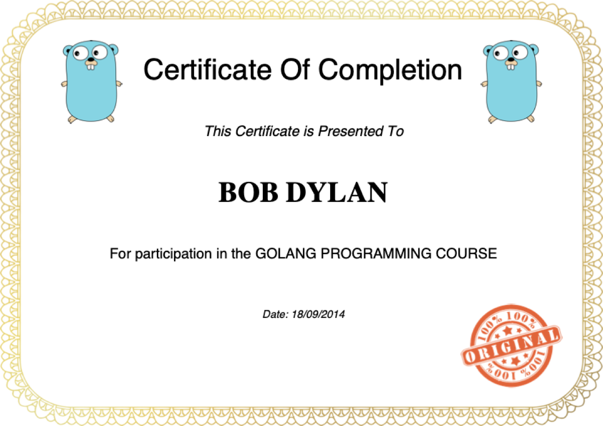

# go-gencert

A command-line certificate generator written in Go. It reads a CSV file of students and creates a **certificate of completion** for each one, either as a **PDF** or as an **HTML** page.



## Origin

I wrote this while following the Udemy course **[Le langage Go : formation complète](https://www.udemy.com/course/le-langage-go-formation-complete/learn/)**, a French-language course on Go. This project is the course's fourth exercise (`04-gencert`) and is part of my Go learning.

## Features

- Reads students from a CSV file in the format `course,name,date`.
- Checks each row: course and name must not be empty and must be shorter than a maximum length, and the date must be a valid `YYYY-MM-DD`.
- Two output formats:
  - **PDF** (default): an A4 landscape certificate with a decorative border, two Go gophers, the student's name, the course, the date and a stamp. It is drawn with [gofpdf](https://github.com/jung-kurt/gofpdf).
  - **HTML**: a simple centered page rendered with Go's `html/template`.
- Writes one file per student in an `output/` directory.
- Includes unit tests for the validation logic.

## Getting started

### Requirements

- Go 1.21+ (tested with Go 1.26)

### Build

```bash
git clone git@github.com:tonystrawberry/go-gencert.git
cd go-gencert
go build -o gencert .
```

### Usage

```bash
# PDF certificates (default)
./gencert -file students.csv

# HTML certificates
./gencert -file students.csv -type html
```

| Flag    | Default | Description                       |
| ------- | ------- | --------------------------------- |
| `-file` | none    | Path to the CSV input (required)  |
| `-type` | `pdf`   | Output format: `pdf` or `html`    |

Example output:

```
Saved certificate to 'output/GOLANG PROGRAMMING COURSE Certificate - BOB DYLAN.pdf'
Saved certificate to 'output/GOLANG NETWORK COURSE Certificate - ALICE LIDDELL.pdf'
...
```

> Run the program from the repository root. The PDF generator loads its images from the relative path `img/`.

### Input format

`students.csv` has no header row. Each line is `course,name,date`:

```csv
Golang Programming,Bob Dylan,2014-09-18
Golang Network,Alice Liddell,2016-10-12
```

### Run the tests

```bash
go test ./...
```

## Project structure

```
.
├── main.go              # CLI: flags, choose a Saver, parse the CSV, save each cert
├── students.csv         # Sample input
├── cert/
│   ├── cert.go          # Cert model, Saver interface, validation and labels
│   ├── csvparser.go     # CSV file to []*Cert
│   └── cert_test.go     # Unit tests for validation
├── pdf/
│   └── certpdf.go       # PdfSaver: draws the certificate with gofpdf
├── html/
│   └── certhtml.go      # HtmlSaver: renders the certificate with html/template
├── img/                 # background.png, gopher.png, stamp.png used by the PDF
└── docs/preview.png     # Screenshot used in this README
```

## How it works

### The `Saver` interface: the core design idea

The `cert` package defines a small interface:

```go
type Saver interface {
    Save(c Cert) error
}
```

`pdf.PdfSaver` and `html.HtmlSaver` both implement it. `main.go` chooses one based on `-type` and stores it in a variable of type `cert.Saver`. The rest of the program calls `saver.Save(cert)` without knowing which format it is producing. This is Go's **implicit interface satisfaction**: neither saver has to declare that it implements `Saver`. Adding another format, such as PNG, only needs a new type with a `Save` method.

### `cert/cert.go`: the model and validation

`cert.New(course, name, date)`:

1. **`validateCourse`** trims whitespace, rejects empty or too-long values (`MaxLenCourse = 20`), adds `" course"` if it is missing, and upper-cases the result with `strings.ToTitle`.
2. **`validateName`** applies the same trim, empty and length checks (`MaxLenName = 30`) and upper-cases the name.
3. **`parseDate`** parses the date with Go's reference-time layout `"2006-01-02"`.
4. It builds every text label shown on the certificate (title, "Certificate Of Completion", "This Certificate is Presented To", and so on) once. The output formats just display these labels and don't build any text themselves.

### `cert/csvparser.go`: reading the input

It opens the file, reads every row with `encoding/csv`'s `ReadAll`, and turns each row into a `*Cert` with `cert.New`. The first invalid row stops parsing and returns the error.

### `pdf/certpdf.go`: drawing the PDF

It creates an A4 landscape page with `gofpdf.New(OrientationLandscape, "mm", "A4", "")`, then draws it in layers:

- **Background:** `background.png` stretched to the full page.
- **Header:** a gopher in each top corner and the "Certificate Of Completion" title (Helvetica 40).
- **Body:** centered text using `WriteAligned(..., "C")` and `Ln()` for spacing. The student's name is in Times Bold 40.
- **Footer:** the stamp in the bottom-right corner.

The file is saved to `output/<LabelTitle>.pdf`.

### `html/certhtml.go`: rendering HTML

An inline template string is parsed with `html/template`, and the `Cert` struct is passed straight in, so `{{.Name}}`, `{{.LabelCompletion}}` and the other fields are filled from its fields. `html/template` also escapes the values automatically, which protects the page against HTML injection.

### Go concepts covered

- Interfaces and polymorphism (`Saver`)
- Package organization across several packages in one module
- Command-line flags with the `flag` package
- Reading files with `os` and `encoding/csv`, and `defer f.Close()`
- Validation, error handling and formatted errors with `fmt.Errorf`
- Date parsing and formatting with Go's reference time (`2006-01-02`, `02/01/2006`)
- Templates with `html/template`
- PDF generation with a third-party library (`gofpdf`)
- Unit tests with the `testing` package

## Known limitations

This is learning code, so it has a few rough edges:

- An unknown `-type` prints an error but doesn't exit, so the program then panics on a nil saver.
- `pdf.New` and `html.New` return `nil, nil` if the output directory can't be created, which hides the real error.
- The length checks use `>=`, so the real maximum is one character less than `MaxLen*`.
- `strings.ToTitle` upper-cases the whole string ("BOB DYLAN") rather than producing title case.
- A CSV row with fewer than 3 columns causes a panic, and header rows aren't supported.
- The HTML output has no images, and it prints each file path twice.
- `gofpdf` is archived upstream. Maintained forks such as [`go-pdf/fpdf`](https://github.com/go-pdf/fpdf) exist.
- The original course code had no `go.mod`, since it was written for GOPATH. One was added (module `training.go/gencert`) so it builds with current Go toolchains.

## Credits

- Course: [Le langage Go : formation complète](https://www.udemy.com/course/le-langage-go-formation-complete/learn/) on Udemy
- PDF library: [jung-kurt/gofpdf](https://github.com/jung-kurt/gofpdf)
- The Go gopher was designed by [Renée French](https://reneefrench.blogspot.com/) and is licensed under CC BY 4.0
